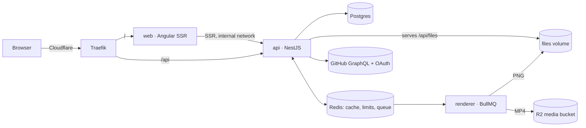

# GitHub Wrapped

Paste a GitHub username and get your year as story slides, plus a one-of-a-kind share card and a public page that unfurls nicely on LinkedIn and X. It uses public data only, and every number links to the GitHub search that proves it.

**[Live demo](https://wrapped.jjimenezm.dev)** · Screenshots: coming with the first public release · [](https://github.com/jjimenezm/github-wrapped/actions/workflows/ci.yml)

Angular 21 (SSR) · NestJS 11 · Prisma + Postgres · BullMQ + Redis · resvg · HyperFrames · Playwright · Docker on a single Dokploy VPS

## What it does

- **Your year in seconds:** contributions, active days, merged PRs, reviews, languages and your standout projects, in Spanish or English. A metric GitHub can't answer is left out rather than estimated.
- **Proof on every number:** each figure links to the GitHub search or view it comes from.
- **A card nobody else has:** choose one of three generative designs (Huella, Cordillera or Constelación). Each is drawn from your own data, so two people with the same numbers still get different art.
- **Publish and share:** sign in with GitHub to publish `/@you/2026`, with a 1080×1350 PNG, a QR code and a link preview. Only the owner can change or delete it; a deleted wrap answers `410 Gone`.
- **A 30-second video:** after publishing, the server renders your year as a 9:16 video in your wrap's language. The share screen shows its place in line, and the public page plays it (Safari on iPhone included).
- **Mobile first:** built for phones, with its own components rather than a desktop layout squeezed down.

## Technical decisions

| Decision                                                                                                                  | Why                                                                                                                                                                                                                                  | Trade-off                                                                                                                                        |
| ------------------------------------------------------------------------------------------------------------------------- | ------------------------------------------------------------------------------------------------------------------------------------------------------------------------------------------------------------------------------------ | ------------------------------------------------------------------------------------------------------------------------------------------------ |
| **The card art is pure TypeScript that returns SVG** (`packages/art`)                                                     | One source draws the card in the browser, the PNG on the server and, next, the video. Same data, same bytes.                                                                                                                         | Effects have to stay within what both browsers and resvg render, so there's no `backdrop-filter`. The glass is faked with SVG.                   |
| **PNG with resvg, not headless Chrome**                                                                                   | It renders in milliseconds and in tens of MB, and the fonts are embedded, so the PNG always matches.                                                                                                                                 | Text layout is done by hand; no HTML or CSS inside the card.                                                                                     |
| **SSR only for the public page** (`/@login/year`)                                                                         | Link previews need server HTML; the rest of the app doesn't. The server reads the wrap from the api over the internal network.                                                                                                       | Two render modes to keep in mind, and a `UrlMatcher`, since `@:user` isn't a valid Angular route segment.                                        |
| **Runtime i18n with Transloco**                                                                                           | Each public page shows in the wrap's own language, which Angular's build-time i18n (one bundle per language) can't do.                                                                                                               | Translations load at runtime.                                                                                                                    |
| **Ownership is GitHub's numeric id, and no user token is stored**                                                         | Renaming an account keeps your wrap; a recycled login can't take it. Sign-in only needs to prove who you are.                                                                                                                        | Nothing can run on the user's behalf later, which is by design.                                                                                  |
| **The data snapshot is one JSONB column**                                                                                 | A wrap is always read whole and never queried by metric.                                                                                                                                                                             | No SQL over individual metrics, which nothing needs.                                                                                             |
| **A separate `renderer` service on a BullMQ queue**                                                                       | Publishing returns at once, and a slow render never blocks the api. Two queues share the worker: PNGs take milliseconds; videos take ~3 minutes each and run one at a time, so a render never starves the site.                      | One more service to run and to health-check.                                                                                                     |
| **Videos in an R2 bucket with its own domain**                                                                            | The server only lets Cloudflare in, and Cloudflare's CDN terms want video in its own storage. R2 serves byte ranges (Safari on iPhone needs them), with free egress.                                                                 | One more external service, and a bucket key in the renderer. A deleted video can stay at the edge for up to an hour (`s-maxage=3600`).           |
| **Every green push to `main` ships: images built in GitHub Actions, published to GHCR, rolled out through Dokploy's API** | Compiling Angular never competes for RAM with live renders on a small server. Each service is pinned to its commit's image (`sha-<short>`), deployed api → renderer → web, and the next one waits until the previous one is healthy. | A deploy waits for the whole CI run, and a key to the Dokploy panel lives in GitHub's secrets (in a `production` environment limited to `main`). |
| **One self-hosted VPS** (Dokploy: web, api, renderer, Postgres, Redis)                                                    | The only cost is the server. Backups go to free off-site storage.                                                                                                                                                                    | Scaling means a bigger server, not more of them. That's fine for a demo.                                                                         |

**How it differs from [GitHub Unwrapped](https://www.githubunwrapped.com/)** (Remotion, React): this one is Angular with HyperFrames for the video. It draws a generative card that's unique to each person, shows only metrics you can verify with a link to their source, and lets you own and delete your page by signing in with GitHub.



## Run locally

You need Node 22 and pnpm 11 (via `corepack`). GitHub is answered from fixtures, so no token is required.

```bash
nvm use && corepack enable
pnpm install && pnpm build
GITHUB_FIXTURES_DIR="$PWD/apps/api/test/fixtures/github" pnpm --filter @wrapped/api start:dev
pnpm --filter @wrapped/web start   # http://localhost:4200, then try "ana-dev"
```

The browser suite starts its own api and web on ports 3201 and 4201:

```bash
pnpm --filter @wrapped/e2e exec playwright install chromium   # once
pnpm --filter @wrapped/e2e test:e2e
```

Without `DATABASE_URL` and `REDIS_URL`, the api keeps wraps in memory and nothing renders. For the full stack, `docker compose -f infra/docker-compose.dev.yml up -d` starts Postgres and Redis, and [`.env.example`](.env.example) documents every variable. [`infra/docker-compose.stack.yml`](infra/docker-compose.stack.yml) runs the production images locally.

## Quality

- **Tests at each level:** Jest unit tests in the api, the renderer and both packages; Vitest in Angular; api end-to-end tests over HTTP; integration tests against real Postgres, Redis and BullMQ; and Playwright in a real browser. On a phone, Playwright walks the whole journey in Spanish and in English: entry, loading, slides, choosing a card, publishing through a stubbed GitHub sign-in, the share screen (it reads the card's QR off the screen), the public page and deleting it down to a `410`. It also covers a metric GitHub fails to answer, publishing with someone else's account, and the server-rendered page and its hydration on a computer.
- **CI on every push and PR:** format, build, lint, typecheck, all of the above, and a secret scan of the whole git history ([gitleaks](https://github.com/gitleaks/gitleaks)). `main` only accepts green builds, and the CI badge covers every job, the browser suite included.
- **Errors you can see:** each domain error has a stable code the web translates (`USER_NOT_FOUND`, `GITHUB_RATE_LIMITED`, `REGENERATE_TOO_SOON`…), per-IP limits return `429` with `Retry-After`, and `/api/health` names the dependency that is down.
- **Safe by construction:** there's an owner guard on every write, the OAuth `state` is signed, the session cookie is `httpOnly`, file paths are built only from validated ids, and the containers run as a non-root user.
- **Operations:** multi-stage images with health checks, migrations on start, continuous deployment from `main` with health-gated rollouts and a one-click rollback to any earlier image, daily Postgres backups off the server, and a deploy guide in [`infra/dokploy.md`](infra/dokploy.md).

## Limits and next steps

- **Videos wait their turn:** one renders at a time, about 20 an hour on the demo server. The share screen says where yours is in line, and it keeps rendering if you close it.
- **Phase 3:** dedicated desktop components. Until then, desktop shows the mobile app inside a phone frame.
- **Contribution counts** use GitHub's own UTC range. They can differ by a few from the profile graph, which uses your local time zone.
