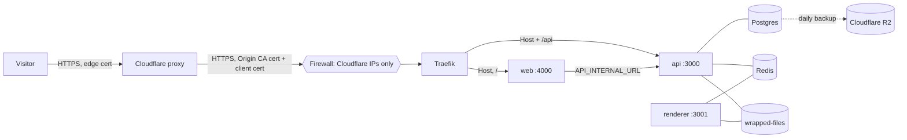

# Deploying on Dokploy

Everything runs on one VPS with [Dokploy](https://dokploy.com): the three images from GHCR, Postgres and Redis as Dokploy databases, and a files volume shared by the api and the renderer. Cloudflare sits in front of it.



## 1. The origin only talks to Cloudflare

Each layer holds even if another one fails:

| Layer                      | Where                                                                                                                           | What it does                                                                                                                                                                                    |
| -------------------------- | ------------------------------------------------------------------------------------------------------------------------------- | ----------------------------------------------------------------------------------------------------------------------------------------------------------------------------------------------- |
| Firewall                   | The cloud provider's firewall, not `ufw` (Docker's published ports bypass it)                                                   | 80 and 443 open only to [Cloudflare's IP ranges](https://www.cloudflare.com/ips/); 22 only from your IP. The Dokploy panel port (3000) is never exposed.                                        |
| Origin certificate         | A Cloudflare Origin CA certificate (15 years) for `example.dev` and `*.example.dev`, added in Dokploy → Settings → Certificates | Traefik's **default** certificate (`tls.stores.default`). Every domain set to Certificate Provider **None** is served with it, so no domain falls back to ACME or to a self-signed certificate. |
| Authenticated Origin Pulls | Traefik `tls.options.default.clientAuth` with Cloudflare's origin-pull CA (`RequireAndVerifyClientCert`)                        | A TLS client that isn't Cloudflare can't even finish the handshake. In the Cloudflare dashboard, turn on the **Global** toggle; Zone-level is for your own client certificates.                 |
| Real client IP             | `forwardedHeaders.trustedIPs` = Cloudflare ranges on Traefik's `web` and `websecure` entry points                               | Traefik keeps Cloudflare's `X-Forwarded-*` headers instead of replacing them.                                                                                                                   |

Cloudflare: SSL/TLS mode **Full (strict)**, DNS records **proxied**, Always Use HTTPS on.

Dynamic files (Dokploy mounts `/etc/dokploy/traefik/dynamic` at the same path inside Traefik):

```yaml
# /etc/dokploy/traefik/dynamic/tls-default.yml
tls:
  stores:
    default:
      defaultCertificate:
        certFile: /etc/dokploy/traefik/dynamic/certificates/<dokploy-folder>/chain.crt
        keyFile: /etc/dokploy/traefik/dynamic/certificates/<dokploy-folder>/privkey.key
```

```yaml
# /etc/dokploy/traefik/dynamic/tls-options.yml
tls:
  options:
    default:
      minVersion: VersionTLS12
      clientAuth:
        caFiles:
          - /etc/dokploy/traefik/dynamic/certificates/origin-pull-ca.pem
        clientAuthType: RequireAndVerifyClientCert
```

The private key of the origin certificate lives only on the server and in a password manager, never in this repository.

> The origin certificate covers `example.dev` and `*.example.dev`, one level deep. Keep every hostname at that level (`wrapped.example.dev`, not `media.wrapped.example.dev`): Cloudflare's free edge certificate has the same limit.

## 2. Images

Pushing a tag `vX.Y.Z` runs [`images.yml`](../.github/workflows/images.yml), which publishes `ghcr.io/<owner>/github-wrapped-{web,api,renderer}` tagged `X.Y.Z`, `X.Y`, `sha-<commit>` and `latest`. Make the three packages public (Package settings → Visibility), or add GHCR as a registry in Dokploy with a token that can read packages.

## 3. Services

Create a project with these resources. The Dokploy **App Name** of each one (with its random suffix) is its hostname on `dokploy-network`.

| Resource | Type                         | Image / version                   | Port                | Volume                          | Memory limit     |
| -------- | ---------------------------- | --------------------------------- | ------------------- | ------------------------------- | ---------------- |
| Postgres | Database                     | `postgres:16`                     | 5432, internal only | Dokploy's own                   | 512 MB           |
| Redis    | Database                     | `redis:7`                         | 6379, internal only | Dokploy's own                   | 256 MB           |
| api      | Application, Docker provider | `…/github-wrapped-api:<tag>`      | 3000                | `wrapped-files` → `/data/files` | 512 MB           |
| renderer | Application, Docker provider | `…/github-wrapped-renderer:<tag>` | 3001, no domain     | `wrapped-files` → `/data/files` | 512 MB (phase 1) |
| web      | Application, Docker provider | `…/github-wrapped-web:<tag>`      | 4000                | none                            | 384 MB           |

- **Shared volume:** in api and renderer, Advanced → Volumes → _Volume mount_, using the same volume name (`wrapped-files`) and mount path (`/data/files`). After both deploy, `docker volume ls` should list it once. The renderer image sets `REQUIRE_FILES_VOLUME=true`, so its health check fails if the mount is missing, instead of writing PNGs where the api can't see them.
- **Memory limits:** Advanced → Resources. Phase 1 adds up to about 2.2 GB of limits, plus roughly 0.7 GB for Dokploy itself (panel, its database, Traefik), on a 4 GB server with 2 GB of swap. The video renderer (phase 2) will need more; size it from its spike measurements.
- **Redis** must keep its default `noeviction` policy (BullMQ requirement). Don't set `maxmemory-policy` to anything else.
- **Health checks** come with the images (`HEALTHCHECK`): the api checks Postgres and Redis, the renderer checks Redis and the volume, and the web checks that it answers. Swarm only routes to healthy tasks and waits for health during a deploy.

## 4. Domains (Traefik)

| Application | Host                  | Path   | Container port | HTTPS | Certificate provider |
| ----------- | --------------------- | ------ | -------------- | ----- | -------------------- |
| web         | `wrapped.example.dev` | `/`    | 4000           | on    | None                 |
| api         | `wrapped.example.dev` | `/api` | 3000           | on    | None                 |

Leave **Strip Path** off: the api serves its routes under `/api`, files included (`/api/files/...`). Traefik ranks the longer rule (`Host && PathPrefix(/api)`) first, so `/api` reaches the api and everything else reaches the web.

## 5. Environment

Values without quotes or spaces (Dokploy writes them as `KEY=value`). Secrets go in Dokploy only.

| Variable                             | api | renderer | web | Value                                                                                                                                                                                                               |
| ------------------------------------ | :-: | :------: | :-: | ------------------------------------------------------------------------------------------------------------------------------------------------------------------------------------------------------------------- |
| `PUBLIC_BASE_URL`                    |  ✓  |    ✓     |  ✓  | `https://wrapped.example.dev`. It's printed in every QR and link, so changing it means regenerating everything published.                                                                                           |
| `DATABASE_URL`                       |  ✓  |    ✓     |     | Postgres "Internal Connection URL" from Dokploy                                                                                                                                                                     |
| `REDIS_URL`                          |  ✓  |    ✓     |     | `redis://default:<password>@<redis-app-name>:6379` (Dokploy's Redis has a password)                                                                                                                                 |
| `GITHUB_SERVER_TOKEN`                |  ✓  |          |     | Fine-grained token, public repositories read-only, from a dedicated account                                                                                                                                         |
| `GITHUB_OAUTH_CLIENT_ID` / `_SECRET` |  ✓  |          |     | OAuth app with callback `https://wrapped.example.dev/api/auth/github/callback`                                                                                                                                      |
| `SESSION_SECRET`                     |  ✓  |          |     | `openssl rand -hex 32`                                                                                                                                                                                              |
| `TRUST_PROXY_HOPS`                   |  ✓  |          |     | `2` behind Cloudflare's proxy (Cloudflare and Traefik each append to `X-Forwarded-For`), `1` with Traefik alone. A wrong value either merges every visitor into one rate limit or lets clients choose their own IP. |
| `RATE_LIMIT_*`                       |  ✓  |          |     | Optional; defaults in [`.env.example`](../.env.example)                                                                                                                                                             |
| `RENDER_IMAGES_CONCURRENCY`          |     |    ✓     |     | `1` (each image takes about 0.2 s)                                                                                                                                                                                  |
| `API_INTERNAL_URL`                   |     |          |  ✓  | `http://<api-app-name>:3000`. The server-rendered page reads its wrap here, not through Cloudflare.                                                                                                                 |

Set by the images, so there's nothing to add: `NODE_ENV=production`, `PORT`, `FILES_DIR=/data/files`, `REQUIRE_FILES_VOLUME=true` (renderer), and `NG_TRUST_PROXY_HEADERS` (web). Without that last one, Angular falls back to client-side rendering for any request carrying Traefik's `X-Forwarded-*` headers, and link previews break. If the domain changes, also set `NG_ALLOWED_HOSTS` on the web (angular.json lists `wrapped.jjimenezm.dev` and `localhost`).

## 6. Deploying a version

1. Push a tag `vX.Y.Z` and wait for **Images** to go green.
2. In Dokploy, change the image tag of api, renderer and web (or keep `latest`), then Deploy each one, api first. The api runs `prisma migrate deploy` before it starts; Prisma takes a lock, so two starting tasks never race.
3. Rollback: deploy the previous tag. Migrations only move forward, so a release that drops a column ships the code change first and the `DROP` in a later release.

## 7. Backups and restore

- **Destination:** Dokploy → Settings → S3 Destinations, using Cloudflare R2 with endpoint `https://<account-id>.r2.cloudflarestorage.com`, region `auto`, a dedicated bucket, and an API token scoped to that bucket.
- **Schedule:** Postgres → Backups, daily (for example `0 4 * * *`), keeping the last 14.
- **Alerts:** Dokploy → Settings → Notifications, with the _Database Backup_ event sent to a channel you read. An uptime monitor won't notice a backup that stopped running.
- **What isn't backed up:** PNGs and videos. They're regenerated from the snapshots.
- **Restore drill:** restore into a clean Postgres, start the api (migrations), then on the renderer run `node dist/backfill.main.js`. It queues the images of every published wrap that's missing them.

## 8. Monitoring

Use an external uptime monitor (free tier) on `https://wrapped.example.dev/api/health` (expect 200 and `"status":"ok"`) and on `https://wrapped.example.dev/`. A monitor inside the VPS can't report the VPS going down.

## 9. Smoke test after a deploy

- `/api/health` → `{"status":"ok","checks":{"postgres":"up","redis":"up"}}`.
- On the server, the renderer answers `{"redis":"up","volume":"up"}`: `docker exec <renderer-task> node -e "fetch('http://127.0.0.1:3001/health').then(r=>r.text()).then(console.log)"`.
- Preview a known user, publish with a test account and download the PNG.
- A published page answers 200 with its `og:image` in the HTML (`curl -s https://wrapped.example.dev/@<login>/2026 | grep -c 'og:image'`). A made-up one answers 404, not 200: a 200 means the server fell back to client-side rendering.
- From two networks, the rate limits are counted separately (this checks `TRUST_PROXY_HOPS`).
- Run the LinkedIn Post Inspector and the X card validator on a public page.
