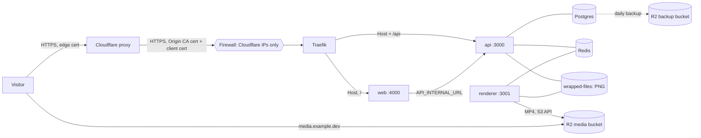
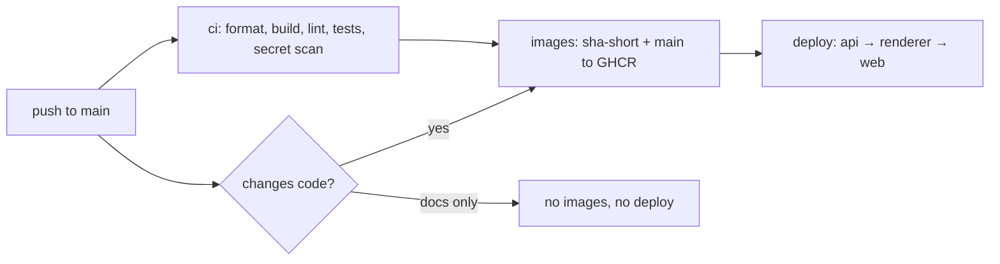

# Deploying on Dokploy

Everything runs on one VPS with [Dokploy](https://dokploy.com): the three images from GHCR, Postgres and Redis as Dokploy databases, and a files volume shared by the api and the renderer. Cloudflare sits in front of it, and the videos live in an R2 bucket that Cloudflare serves from its own domain.



## 1. The origin only talks to Cloudflare

Each layer holds even if another one fails:

| Layer                      | Where                                                                                                                           | What it does                                                                                                                                                                                    |
| -------------------------- | ------------------------------------------------------------------------------------------------------------------------------- | ----------------------------------------------------------------------------------------------------------------------------------------------------------------------------------------------- |
| Firewall                   | The cloud provider's firewall, not `ufw` (Docker's published ports bypass it)                                                   | 80 and 443 open only to [Cloudflare's IP ranges](https://www.cloudflare.com/ips/); 22 only from your IP. The Dokploy panel port (3000) is never exposed.                                        |
| Origin certificate         | A Cloudflare Origin CA certificate (15 years) for `example.dev` and `*.example.dev`, added in Dokploy → Settings → Certificates | Traefik's **default** certificate (`tls.stores.default`). Every domain set to Certificate Provider **None** is served with it, so no domain falls back to ACME or to a self-signed certificate. |
| Authenticated Origin Pulls | Traefik `tls.options.default.clientAuth` with Cloudflare's origin-pull CA (`RequireAndVerifyClientCert`)                        | A TLS client that isn't Cloudflare can't even finish the handshake. In the Cloudflare dashboard, turn on the **Global** toggle; Zone-level is for your own client certificates.                 |
| Real client IP             | `forwardedHeaders.trustedIPs` = Cloudflare ranges on Traefik's `web` and `websecure` entry points                               | Traefik keeps Cloudflare's `X-Forwarded-*` headers instead of replacing them.                                                                                                                   |

Cloudflare: SSL/TLS mode **Full (strict)**, DNS records **proxied**, Always Use HTTPS on.

Dynamic files (Dokploy mounts `/etc/dokploy/traefik/dynamic` at the same path inside Traefik):

```yaml
# /etc/dokploy/traefik/dynamic/tls-default.yml
tls:
  stores:
    default:
      defaultCertificate:
        certFile: /etc/dokploy/traefik/dynamic/certificates/<dokploy-folder>/chain.crt
        keyFile: /etc/dokploy/traefik/dynamic/certificates/<dokploy-folder>/privkey.key
```

```yaml
# /etc/dokploy/traefik/dynamic/tls-options.yml
tls:
  options:
    default:
      minVersion: VersionTLS12
      clientAuth:
        caFiles:
          - /etc/dokploy/traefik/dynamic/certificates/origin-pull-ca.pem
        clientAuthType: RequireAndVerifyClientCert
```

The private key of the origin certificate lives only on the server and in a password manager, never in this repository.

> The origin certificate covers `example.dev` and `*.example.dev`, one level deep. Keep every hostname at that level (`wrapped.example.dev`, not `media.wrapped.example.dev`): Cloudflare's free edge certificate has the same limit.

## 2. Images

[`images.yml`](../.github/workflows/images.yml) builds `ghcr.io/<owner>/github-wrapped-{web,api,renderer}` in GitHub Actions and publishes them to GHCR:

| Trigger                                          | Tags                                                                                         |
| ------------------------------------------------ | -------------------------------------------------------------------------------------------- |
| A push to `main` that passes CI and changes code | `sha-<short commit>` (immutable, the one that gets deployed) and `main` (follows the branch) |
| A release tag `vX.Y.Z`                           | `X.Y.Z`, `X.Y` and `latest`                                                                  |

Make the three packages public (Package settings → Visibility), or add GHCR as a registry in Dokploy with a token that can read packages.

## 3. Services

Create a project with these resources. The Dokploy **App Name** of each one (with its random suffix) is its hostname on `dokploy-network`.

| Resource | Type                         | Image / version                   | Port                | Volume                          | Memory limit     |
| -------- | ---------------------------- | --------------------------------- | ------------------- | ------------------------------- | ---------------- |
| Postgres | Database                     | `postgres:16`                     | 5432, internal only | Dokploy's own                   | 512 MB           |
| Redis    | Database                     | `redis:7`                         | 6379, internal only | Dokploy's own                   | 256 MB           |
| api      | Application, Docker provider | `…/github-wrapped-api:<tag>`      | 3000                | `wrapped-files` → `/data/files` | 512 MB           |
| renderer | Application, Docker provider | `…/github-wrapped-renderer:<tag>` | 3001, no domain     | `wrapped-files` → `/data/files` | 1.5 GB, 1.5 vCPU |
| web      | Application, Docker provider | `…/github-wrapped-web:<tag>`      | 4000                | none                            | 384 MB           |

- **Shared volume:** in api and renderer, Advanced → Volumes → _Volume mount_, using the same volume name (`wrapped-files`) and mount path (`/data/files`). After both deploy, `docker volume ls` should list it once. The renderer image sets `REQUIRE_FILES_VOLUME=true`, so its health check fails if the mount is missing, instead of writing PNGs where the api can't see them.
- **Memory and CPU limits:** Advanced → Resources. The limits add up to about 3.2 GB, plus roughly 0.7 GB for Dokploy itself (panel, its database, Traefik), on a 4 GB server with 7.9 GB of swap. They are caps, not reservations: measured on the server, a 30-second video render peaks at ~700 MB and 1.6 of the 2 vCPU, the host keeps ~1.6 GB available and no swap is touched. The renderer's **CPU limit of 1.5** leaves half a core to the web, the api and Postgres while a video renders.
- **Redis** must keep its default `noeviction` policy (BullMQ requirement). Don't set `maxmemory-policy` to anything else.
- **Health checks** come with the images (`HEALTHCHECK`): the api checks Postgres and Redis, the renderer checks Redis and the volume, and the web checks that it answers. Swarm only routes to healthy tasks and waits for health during a deploy.

## 4. Domains (Traefik)

| Application | Host                  | Path   | Container port | HTTPS | Certificate provider |
| ----------- | --------------------- | ------ | -------------- | ----- | -------------------- |
| web         | `wrapped.example.dev` | `/`    | 4000           | on    | None                 |
| api         | `wrapped.example.dev` | `/api` | 3000           | on    | None                 |

Leave **Strip Path** off: the api serves its routes under `/api`, files included (`/api/files/...`). Traefik ranks the longer rule (`Host && PathPrefix(/api)`) first, so `/api` reaches the api and everything else reaches the web.

## 5. Environment

Values without quotes or spaces (Dokploy writes them as `KEY=value`). Secrets go in Dokploy only.

| Variable                             | api | renderer | web | Value                                                                                                                                                                                                                   |
| ------------------------------------ | :-: | :------: | :-: | ----------------------------------------------------------------------------------------------------------------------------------------------------------------------------------------------------------------------- |
| `PUBLIC_BASE_URL`                    |  ✓  |    ✓     |  ✓  | `https://wrapped.example.dev`. It's printed in every QR and link, so changing it means regenerating everything published.                                                                                               |
| `DATABASE_URL`                       |  ✓  |    ✓     |     | Postgres "Internal Connection URL" from Dokploy                                                                                                                                                                         |
| `REDIS_URL`                          |  ✓  |    ✓     |     | `redis://default:<password>@<redis-app-name>:6379` (Dokploy's Redis has a password)                                                                                                                                     |
| `GITHUB_SERVER_TOKEN`                |  ✓  |          |     | Fine-grained token, public repositories read-only, from a dedicated account                                                                                                                                             |
| `GITHUB_OAUTH_CLIENT_ID` / `_SECRET` |  ✓  |          |     | OAuth app with callback `https://wrapped.example.dev/api/auth/github/callback`                                                                                                                                          |
| `SESSION_SECRET`                     |  ✓  |          |     | `openssl rand -hex 32`                                                                                                                                                                                                  |
| `TRUST_PROXY_HOPS`                   |  ✓  |          |     | `2` behind Cloudflare's proxy (Cloudflare and Traefik each append to `X-Forwarded-For`), `1` with Traefik alone. A wrong value either merges every visitor into one rate limit or lets clients choose their own IP.     |
| `RATE_LIMIT_*`                       |  ✓  |          |     | Optional; defaults in [`.env.example`](../.env.example)                                                                                                                                                                 |
| `RENDER_IMAGES_CONCURRENCY`          |     |    ✓     |     | `1` (each image takes about 0.2 s)                                                                                                                                                                                      |
| `RENDER_VIDEO_ENABLED`               |  ✓  |    ✓     |     | `true` to render the 30-second video after publishing or regenerating. Set it on **both**: the api queues the videos, the renderer runs their worker. Unset, wraps show no video at all.                                |
| `RENDER_VIDEO_CONCURRENCY`           |     |    ✓     |     | `1`. One render takes most of the CPU; two at a time don't finish sooner and starve the web and the api.                                                                                                                |
| `RENDER_VIDEO_TIMEOUT_MS`            |     |    ✓     |     | `600000` (10 min, about three times a measured render). A render that takes longer is stopped and fails for good; the owner can retry it.                                                                               |
| `PUBLIC_MEDIA_URL`                   |  ✓  |          |     | `https://media.example.dev`, the media bucket's own domain (section 8). The public page and the share screen link the videos there. Unset, videos stay on the files volume and the api serves them (local development). |
| `R2_ENDPOINT`                        |     |    ✓     |     | `https://<account-id>.r2.cloudflarestorage.com` (R2 → the bucket → Settings → S3 API, without the bucket name)                                                                                                          |
| `R2_BUCKET`                          |     |    ✓     |     | The media bucket's name                                                                                                                                                                                                 |
| `R2_ACCESS_KEY_ID` / `_SECRET_…`     |     |    ✓     |     | `R2_ACCESS_KEY_ID` and `R2_SECRET_ACCESS_KEY` of an R2 API token with **Object Read & Write** on the media bucket only. Only the renderer holds it: it uploads the videos and deletes them.                             |
| `RENDER_VIDEO_LOW_MEMORY`            |     |    ✓     |     | Optional. `retry` (default): the first attempt uses BeginFrame capture (~11 % faster) and the automatic retry HyperFrames' low-memory profile. `always` or `never` force one of them.                                   |
| `API_INTERNAL_URL`                   |     |          |  ✓  | `http://<api-app-name>:3000`. The server-rendered page reads its wrap here, not through Cloudflare.                                                                                                                     |

Set by the images, so there's nothing to add: `NODE_ENV=production`, `PORT`, `FILES_DIR=/data/files`, `REQUIRE_FILES_VOLUME=true` (renderer), and `NG_TRUST_PROXY_HEADERS` (web). Without that last one, Angular falls back to client-side rendering for any request carrying Traefik's `X-Forwarded-*` headers, and link previews break. If the domain changes, also set `NG_ALLOWED_HOSTS` on the web (angular.json lists `wrapped.jjimenezm.dev` and `localhost`).

## 6. Releases and rollback

Every push to `main` that passes CI is deployed. One run of [`ci.yml`](../.github/workflows/ci.yml) chains it all:



- **What ships:** [`needs-deploy.sh`](../.github/scripts/needs-deploy.sh) compares the push with the previous head. Markdown, `LICENSE`, editor and git settings, `.env.example`, the browser end-to-end suite (`e2e/`) and the local compose files don't rebuild or redeploy; anything else does, workflows included.
- **How it deploys:** [`deploy.yml`](../.github/workflows/deploy.yml) runs [`dokploy-deploy.sh`](../.github/scripts/dokploy-deploy.sh) against the Dokploy API. For each service it sets the application's image to `…:sha-<short>` (`application.update`), deploys it (`application.deploy`), waits for Dokploy's deployment to finish, then for the Swarm service's rolling update to complete (`docker.getConfig` on the service, `UpdateStatus`). Dokploy updates start-first with automatic rollback, and a task only counts as running once its `HEALTHCHECK` passes, so the next service starts only when the previous one is healthy on the new image. The api goes first because it runs `prisma migrate deploy` before it starts (Prisma takes a lock, so two starting tasks never race).
- **Traceability:** each application in Dokploy shows the exact commit in its image tag, each Dokploy deployment is titled with the tag and links the Actions run, and GitHub's **production** environment lists every deploy with its commit.
- **One deploy at a time:** pushes to `main` queue instead of cancelling each other, so a deploy is never cut halfway and an older commit never lands after a newer one. While a run waits, a newer push replaces it.
- **When it fails:** the failing service stays on its previous version (Swarm rolled it back, or never switched), its application is pointed back at its previous image, and the services after it aren't touched. The ones before it keep the new image; the run's summary lists which. Fix forward, or roll back.

**Rollback:** Actions → **Deploy** → Run workflow on `main`, with an earlier tag: `sha-<short>` (from the deploy list of the `production` environment or the package versions in GHCR) or a release such as `0.1.0`. The workflow first checks that the three images exist. The next push to `main` deploys again on top of it; to stay on the old version, revert the commit on `main`. Migrations only move forward, so a rollback doesn't undo one: a release that drops a column ships the code change first and the `DROP` in a later release.

**Releases:** a tag `vX.Y.Z` only publishes versioned images (that commit was already deployed from `main`). Use it to name a point you may want to roll back to.

### One-time setup

1. **API key.** In Dokploy, Settings → Profile → **API/CLI Keys** → Generate New Key: a name such as `github-actions`, an expiration (a year, with a reminder to rotate it), your organization, and rate limiting off (or at least 120 requests a minute: a deploy polls every 5 seconds). The key is shown once. It acts as the user who created it, so it can do anything that user can do on the panel: treat it like the panel's password, and delete it in the same place if it leaks.
2. **Application ids.** Open each application (api, renderer, web) in Dokploy. The id is the last segment of the URL: `/dashboard/project/<projectId>/environment/<environmentId>/services/application/<applicationId>`.
3. **GitHub environment.** Repository → Settings → Environments → New environment `production`. Under Deployment branches and tags, choose _Selected branches and tags_ and add `main`, so no other branch can reach these secrets. Then add these environment secrets (secrets rather than variables, because the logs of a public repository are public):

   | Secret                    | Value                                                |
   | ------------------------- | ---------------------------------------------------- |
   | `DOKPLOY_URL`             | The panel's URL, such as `https://panel.example.dev` |
   | `DOKPLOY_API_KEY`         | The key from step 1                                  |
   | `DOKPLOY_APP_ID_API`      | The api's application id                             |
   | `DOKPLOY_APP_ID_RENDERER` | The renderer's application id                        |
   | `DOKPLOY_APP_ID_WEB`      | The web's application id                             |

4. **The runner has to reach the panel.** GitHub's runners call the panel from changing cloud IPs, through Cloudflare like any visitor, so the firewall (Cloudflare IPs only) and Authenticated Origin Pulls let them through. What can stop them:
   - **Bot Fight Mode** challenges automated clients, and on the free plan no WAF rule can skip it. Keep it off in the panel's zone, or the API answers 403 with a challenge page.
   - A **WAF custom rule** or a high Security Level on the panel's host: let `/api/` through for requests carrying `x-api-key`.
   - **Cloudflare Access** in front of the panel: create a service token, allow it in the application's policy (_Service Auth_), and add it as the secrets `CF_ACCESS_CLIENT_ID` and `CF_ACCESS_CLIENT_SECRET`; the script sends them when they're set.
   - An **IP allowlist** that skips Cloudflare (the panel open only to your IP): hosted runners can't pass it. Use Access instead, or a self-hosted runner inside the allowlist.

To check the setup without waiting for a push, run **Deploy** by hand with the tag that is already live.

## 7. Backups and restore

- **Destination:** Dokploy → Settings → S3 Destinations, using Cloudflare R2 with endpoint `https://<account-id>.r2.cloudflarestorage.com`, region `auto`, a dedicated bucket, and an API token scoped to that bucket.
- **Schedule:** Postgres → Backups, daily (for example `0 4 * * *`), keeping the last 14.
- **Alerts:** Dokploy → Settings → Notifications, with the _Database Backup_ event sent to a channel you read. An uptime monitor won't notice a backup that stopped running.
- **What isn't backed up:** PNGs and videos. They're regenerated from the snapshots.
- **Restore drill:** restore into a clean Postgres, start the api (migrations), then on the renderer run `node dist/backfill.main.js`. It queues the images of every published wrap that's missing them and, with `RENDER_VIDEO_ENABLED`, their videos (one at a time, ~3 minutes each).

## 8. Turning videos on

### The media bucket

Videos don't go through the server: Cloudflare's CDN terms ask for its own storage for video, and the server only lets Cloudflare in. Each video is uploaded to R2 as `wrapped/<wrap-id>/<data-version>.mp4` and served from `https://media.example.dev/wrapped/…`, byte ranges included (Safari on iPhone needs them). R2's free tier is 10 GB, about 900 videos.

1. **Bucket:** Cloudflare → R2 → Create bucket (for example `jjimenezm-media`), location Automatic. Keep it apart from the backups bucket, which must never be public.
2. **Domain:** the bucket → Settings → Custom Domains → Connect Domain → `media.example.dev`. Cloudflare creates the proxied DNS record and the certificate. Keep it one level deep (`media.example.dev`, not `media.wrapped.example.dev`), and leave the `r2.dev` public URL disabled.
3. **Key:** R2 → Manage API Tokens → Create API token, permission **Object Read & Write**, applied to that bucket only. Copy the access key id and the secret; they are shown once.
4. **Renderer:** set `R2_ENDPOINT`, `R2_BUCKET`, `R2_ACCESS_KEY_ID` and `R2_SECRET_ACCESS_KEY`. **api:** set `PUBLIC_MEDIA_URL=https://media.example.dev`. The api never gets the key: deleting a wrap queues a purge, and the renderer empties that wrap's folder in the bucket (retrying for about a quarter of an hour if R2 is out).

**Nothing piles up.** Each published wrap keeps one video: the previous one is deleted once a regenerated one is ready, and a deleted wrap's folder is purged. On top of that, every day at 05:00 UTC the renderer sweeps the bucket and deletes every video no published wrap uses (whatever a failed purge left), logging `daily sweep: deleted N video(s)`. So the bucket holds about 11 MB per published wrap: the 10 GB free tier covers ~900 wraps, and past that it costs USD 0.015 per GB a month. Cloudflare has no spending cap, so set a usage alert anyway: Notifications → Add → _Usage Based Billing_ → R2 storage.

Each MP4 is stored with `Cache-Control: public, max-age=31536000, s-maxage=3600, immutable`: browsers keep it (a version never changes), and Cloudflare's edge checks back with R2 every hour, so a deleted video stops being served within the hour without purging the cache. No CORS rule is needed: `<video src>` doesn't ask for one.

### Switching it on

The renderer image carries everything a video needs, pinned to the versions measured on the server: HyperFrames 0.9.16, the chrome-headless-shell it pins (downloaded at build time, so renders need no network) and FFmpeg n8.0.1. Each video is rendered at 30 fps with the `looks` quality and a single Chrome. Measured on the server it takes about 3 minutes (3 m 10 s without a CPU limit, ~3.5 min with the 1.5 vCPU cap), peaks at ~710 MB and weighs about 11 MB.

1. Deploy the release (api → renderer → web, as every push does).
2. In the renderer, Advanced → Resources: memory **1.5 GB** and CPU **1.5**. Redeploy it.
3. On the **renderer**, set the four `R2_*` variables and `RENDER_VIDEO_ENABLED=true` (Environment → Save → Redeploy). Then on the **api**, set `PUBLIC_MEDIA_URL` and `RENDER_VIDEO_ENABLED=true` and redeploy it. In that order, the api queues videos only once the renderer can render and upload them.
4. Queue the videos of the wraps published before: on the renderer, `docker exec <renderer-task> node dist/backfill.main.js`. Running it twice queues nothing new.
5. Check the logs of the renderer: `videos go to the "<bucket>" bucket` and `listening on "video" with concurrency 1…` at start, then `video video-<id>-<version> rendered in <seconds> s` after each render.

To turn videos off again, unset `RENDER_VIDEO_ENABLED` on the api (nothing new is queued) and then on the renderer. Videos already rendered keep playing.

## 9. Monitoring

Use an external uptime monitor (free tier) on `https://wrapped.example.dev/api/health` (expect 200 and `"status":"ok"`) and on `https://wrapped.example.dev/`. A monitor inside the VPS can't report the VPS going down.

## 10. Smoke test after a deploy

- `/api/health` → `{"status":"ok","checks":{"postgres":"up","redis":"up"}}`.
- On the server, the renderer answers `{"redis":"up","volume":"up"}`: `docker exec <renderer-task> node -e "fetch('http://127.0.0.1:3001/health').then(r=>r.text()).then(console.log)"`.
- Preview a known user, publish with a test account and download the PNG.
- A published page answers 200 with its `og:image` in the HTML (`curl -s https://wrapped.example.dev/@<login>/2026 | grep -c 'og:image'`). A made-up one answers 404, not 200: a 200 means the server fell back to client-side rendering.
- From two networks, the rate limits are counted separately (this checks `TRUST_PROXY_HOPS`).
- Run the LinkedIn Post Inspector and the X card validator on a public page.
- With videos on: publish with a test account, watch the share screen go from "In line" to "Making your 30 s video" to the green dot within about 3–4 minutes, and play the video on the public page, Safari on iPhone included.
